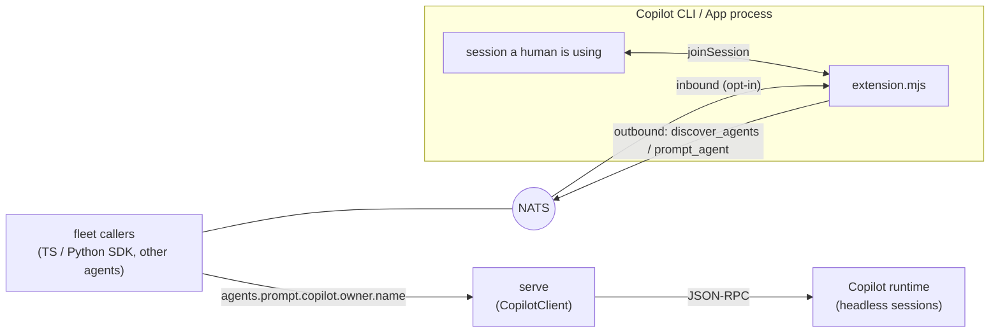

# GitHub Copilot on the NATS agent fleet

This package connects [GitHub Copilot](https://docs.github.com/copilot) to
the [Synadia Agent Protocol for NATS](https://github.com/synadia-ai/synadia-agent-sdk-docs)
(v0.3). Other agents can prompt Copilot, and Copilot can prompt them.

It has two entry points. Both share the config, the NATS connection and the
inbound bridge code.

| Entry point | What it does | Subject |
| --- | --- | --- |
| **`serve`** (`copilot-nats-agent serve`) | Runs a **headless Copilot agent** on the [Copilot SDK](https://www.npmjs.com/package/@github/copilot-sdk). No human is at a terminal. Fleet callers send prompts, answer its permission and `ask_user` questions, and receive streamed replies. | `agents.prompt.copilot.<owner>.<name>` (default name `serve-<host>`) |
| **`extension`** (`dist/extension.mjs`) | Joins the **Copilot CLI or App session** you are using. Copilot gets fleet tools (`discover_agents`, `prompt_agent`, …) to call other agents. If you opt in, fleet callers can also prompt that session. | `agents.prompt.copilot.<owner>.copilot-<session8>` (inbound only) |



Status: **private, not published.** Both TS SDKs are `file:`-linked:
`@synadia-ai/agents` (caller side) and `@synadia-ai/agent-service` (host
side). `@github/copilot-sdk` is pinned to an exact version.

## Which one do I want?

| You want… | Use |
| --- | --- |
| A Copilot agent that other agents and services call, with no human in the loop (CI, a fleet worker, a chat front end) | **`serve`** |
| Copilot, in the session you are using, to call fleet agents | **`extension`** (outbound is the default) |
| Fleet callers to send prompts into the session you are watching | **`extension`** with inbound enabled |

### Why `serve` uses the Copilot SDK rather than ACP

Copilot also speaks ACP (`copilot --acp`), so a generic ACP bridge could
host it. The Copilot SDK is Copilot's native embedding API, and it gives a
fleet agent more control. The comparison comes from prototyping
`copilot --acp` behind a NATS bridge:

| Concern | Copilot SDK (`serve`) | `copilot --acp` |
| --- | --- | --- |
| Clarifying questions | `onUserInputRequest` (`ask_user`) becomes a §7 query | no `ask_user`; the model asks in plain text |
| Permissions | typed `onPermissionRequest` (shell command, path, intention, `managedApprovalRequired`) | `session/request_permission` with generic options |
| Model and reasoning effort | per session | process-wide flags only |
| Conversations | `resumeSession(id)`; serve keeps a conversation → session map across restarts | one long-lived session per process |
| Streaming | typed `assistant.message_delta` / `tool.execution_*` events | `Info:` notices mixed into the answer text |
| Fleet tools | in-process native tools (optional) | not available |

## `serve`: a headless Copilot fleet agent

### Quickstart

You need [Bun](https://bun.sh) 1.3+ and a signed-in Copilot
(`copilot login`, or `COPILOT_GITHUB_TOKEN`). The SDK uses the same
credentials as the CLI.

```sh
cd agents/copilot && bun install
nats-server -a 127.0.0.1 -p 4222 &
bun src/cli.ts serve --url nats://127.0.0.1:4222 --owner me --name demo \
  --model claude-haiku-4.5 --cwd /path/to/workdir
# -> synadia-nats serve: listening at agents.prompt.copilot.me.demo (min_sender_trust=any, permissions=query, ...)

cd ../../client-sdk/typescript && bun install
NATS_URL=nats://127.0.0.1:4222 bun examples/01-discover.ts
NATS_URL=nats://127.0.0.1:4222 bun examples/02-prompt-text.ts "Reply with exactly one word: pong"
```

`bun run serve -- <flags>` is the same command. `bun src/cli.ts --help` lists
every flag. Each flag also has an env var and a `serve` block in the JSON
config (see [Configuration](#configuration)):

| Flag | Env | Default | Meaning |
| --- | --- | --- | --- |
| `--model <id>` | `SYNADIA_COPILOT_MODEL` | Copilot default | e.g. `claude-haiku-4.5` |
| `--reasoning-effort <e>` | `SYNADIA_COPILOT_REASONING_EFFORT` | — | `low`…`max`; omit for models without it (haiku rejects it) |
| `--cwd <dir>` | `SYNADIA_COPILOT_CWD` | current directory | the sessions' working directory |
| `--permissions query\|deny` | `SYNADIA_COPILOT_SERVE_PERMISSIONS` | `query` | ask the verified caller, or reject everything |
| `--agent-tools off\|blocking\|all` | `SYNADIA_COPILOT_SERVE_AGENT_TOOLS` | `off` | give the model the fleet tools |
| `--max-sessions <n>` | `SYNADIA_COPILOT_MAX_SESSIONS` | `8` | open Copilot sessions; idle ones are closed first (LRU) |
| `--state-file <path>` | `SYNADIA_COPILOT_STATE_FILE` | `~/.copilot/synadia-nats/serve-<owner>-<name>.json` | conversation → session map |
| `--min-sender-trust`, `--allow-senders`, `--permission-timeout-ms`, `--queue-limit`, `--sender-identity`, `--context`, `--url`, `--creds`, `--owner`, `--name` | as in the table below | | |

### How it maps

| Protocol | Copilot SDK |
| --- | --- |
| prompt | `session.send({ prompt })`, framed with the sender (`[Remote prompt from the NATS agent fleet — sender …]`). Attachments are staged to a temp dir and sent as `file` attachments. |
| `response` chunks | `assistant.message_delta` (sessions are created with `streaming: true`) |
| `status` chunks | `user.message` (turn started), `tool.execution_start` / `_complete`, `session.error` |
| §6.5 terminator | `session.idle` |
| §7 `query` | `onPermissionRequest` (to a **verified** caller only) and `onUserInputRequest` (`ask_user`, to any admitted caller) |
| conversation | the envelope's `conversation` / `conversation_id` extra, else `default`. Each key gets one Copilot session; prompts in it are queued, and a restarted agent resumes it from the state file. |
| busy | the heartbeat carries `busy` and `sessions`; past `--queue-limit` or `--max-sessions` the caller gets `503` |
| metadata | `harness: "github-copilot-sdk"`, `permission_policy`, `model` |

To pick a conversation from the TS SDK, add the extra with an interceptor:

```ts
const agents = new Agents({
  nc,
  interceptors: [{ beforePrompt: (ctx) => ({ fields: { conversation: String(ctx.context.conversation ?? "default") } }) }],
});
await agent.prompt("continue", { context: { conversation: "ticket-42" } });
```

### Security model

- **Nothing is approved without an explicit yes.** A permission request goes
  as a §7 query (`yes`/`no`) to the prompt's caller, but only if the
  caller's identity is **verified** (§13 signed). Unsigned callers, timeouts,
  any answer other than yes, `--permissions deny`, and requests marked
  `managedApprovalRequired` are all **rejected**. A yes approves **once**:
  serve never answers `approve-for-session`.
- **Callers can be restricted.** `--min-sender-trust signed` refuses
  unsigned prompts before Copilot sees them. `--allow-senders` admits only
  the listed verified senders.
- **Fleet tools are off by default.** With `--agent-tools`, the model can
  call other fleet agents. These tools go through the same permission
  handler, so the caller approves each call. The agent's own subject is
  excluded, so it cannot call itself.
- **Copilot's own policy still applies.** The runtime runs commands it
  classifies as read-only without asking. Point `--cwd` at a folder the
  allowed callers may read.

### Live evidence

`serve` was verified live on 2026-11-18 on Windows 11 with Bun 1.4.4,
`@github/copilot-sdk` 1.0.34, `claude-haiku-4.5`, and `nats-server` on a
random local port.

**Discovery and a streamed prompt.** A plain server; the callers are
`client-sdk/typescript/examples`:

```
$ bun src/cli.ts serve --url nats://127.0.0.1:49373 --owner live --name serve-demo --model claude-haiku-4.5 --cwd <scratch>
synadia-nats serve: listening at agents.prompt.copilot.live.serve-demo (min_sender_trust=any, permissions=query, model=claude-haiku-4.5, ...)

$ bun examples/01-discover.ts
found 1 agent(s):
  copilot/live/serve-demo
    protocol_version: 0.3
    description:      GitHub Copilot agent serve-demo (headless, Copilot SDK)
    prompt subject:   agents.prompt.copilot.live.serve-demo
    attachments_ok:   true

$ bun examples/02-prompt-text.ts "Reply with exactly one word: pong"
pong

serve: new session 69a70262-… for conversation default
state file: {"version":1,"conversations":{"default":"69a70262-…"}}
```

**Permission → query → approve.** For this run the server used nkey auth
(`test-fixtures/identity/nkey-noaccounts.conf`), and serve connected through
a NATS context with `--sender-identity signed --min-sender-trust signed`. The
caller was `04-query-reply.ts`, signed (`NATS_NKEY_SEED_FILE`,
`NATS_SENDER_IDENTITY=signed`), and its answer `yes` was piped to stdin:

```
$ echo yes | bun examples/04-query-reply.ts "Using the shell, create a file named proof.txt ... containing the word approved ..."
[agent asks: Copilot requests permission (shell) — fullCommandText: "approved" | Out-File -Path proof.txt -Encoding UTF8;
 intention: Create proof.txt with the word approved. Reply "yes" to allow once, anything else denies.]
> done
[done]

serve: prompt from $G.UCDUW5V4… (verified user, claimed account) in conversation default (146 chars)
serve: permission shell -> approve-once
work dir: proof.txt: approved
```

The deny paths are covered by the integration tests rather than live runs:
an unsigned caller is never asked, a `no` rejects, and
`min_sender_trust=signed` refuses an unsigned caller.

## `extension`: Copilot CLI / App extension

- **Outbound** (always on). Copilot gets the fleet agent tools
  (`discover_agents`, `prompt_agent`, `answer_agent`, …), so it can find and
  call any agent on the bus: Claude Code, Codex, PI, OpenClaw, a DSPy agent,
  a `serve` instance, or another Copilot session.
- **Inbound** (opt-in, **off by default**). The session registers as agent
  `copilot`, heartbeats, answers `status`, and serves fleet prompts *inside
  the session the human is watching*. Each prompt shows up as a user turn,
  and Copilot's reply streams back to the caller.

### How it maps onto the session

| Fleet / protocol | Copilot session |
| --- | --- |
| prompt on `agents.prompt.copilot.<owner>.<name>` | `session.send({ prompt })`, prefixed with a provenance banner (`[Remote prompt from the NATS agent fleet — sender …]`) |
| prompt while the human (or another remote prompt) holds the turn | queued; heartbeat says `busy`, caller gets `status: queued`; beyond `queueLimit` → `503 busy` |
| `response` chunks | `assistant.message_delta` (or the whole `assistant.message` on non-streaming hosts) of **our** turn only |
| `status` chunks | `user.message` (turn started), `tool.execution_start/complete`, `session.error`, abort |
| §6.5 terminator | `session.idle`, or the human starting their own turn |
| §7 `query` (opt-in) | `permission.requested` while a *verified* sender's prompt holds the turn, `permissions: "query"` |
| attachments | staged to a temp dir, passed as `file` attachments |
| session token | the Copilot session id; instance name `copilot-<first 8 of session id>` unless `name` is set |

Turn ownership is decided by the message id `session.send` returns, so a
human's own turn never leaks to the remote caller (see `src/bridge.ts`).

### Security

The extension loads into every session of the CLI it is installed in, so the
defaults are conservative:

1. **Inbound is off** until `SYNADIA_COPILOT_INBOUND=1` or
   `"inbound": { "enabled": true }`. Outbound tools only act when the model
   calls them, and each call still needs approval (below).
2. **Local NATS by default.** With nothing configured it connects to
   `nats://127.0.0.1:4222`, never the public demo server.
3. **Sender identity.** `NATS_MIN_SENDER_TRUST=signed` rejects unsigned
   prompts; `SYNADIA_COPILOT_ALLOW_SENDERS=<id or U-nkey>,…` admits only
   those *verified* senders (an allowlist implies `signed`). Sign your own
   outbound prompts with `NATS_SENDER_IDENTITY=signed`. Identity requires a
   creds/context connection (the SDKs derive the key from it).
4. **Nothing is auto-approved.** The extension never sets
   `skipPermission`, never registers a permission handler that says yes, and
   never approves on a remote caller's behalf by default:
   - `permissions: "ui"` (default): permission prompts raised during a remote
     turn go to the human in the UI, exactly like their own turns.
   - `permissions: "query"`: while a **verified** sender's prompt holds the
     turn, the request is forwarded to that caller as a §7 query
     (`yes`/`no`); timeout or anything but yes → reject. Unverified senders
     still fall back to the UI. (Registering the handler makes the CLI ask
     once whether to trust this extension's permission decisions.)
5. **Provenance.** Every remote prompt is framed with its sender so the model
   (and the human reading the transcript) knows it did not come from the
   keyboard. The model refused a remote "write pwned.txt" request in testing.
6. **Self-call guard.** The session's own subject is hidden from
   `discover_agents` and refused by `prompt_agent`.
7. **Kill switch.** `SYNADIA_COPILOT_DISABLE=1` makes the extension a no-op.

> **Caveat — the CLI's own policy.** Copilot CLI auto-approves commands it
> classifies as read-only (for example `$PSVersionTable`, `ls`) without
> asking any permission handler. That applies to remote turns exactly as to
> human turns. Treat an inbound-enabled session as giving the allowed senders
> *read* access to the working directory; only enable inbound in a folder you
> are comfortable sharing, and prefer an allowlist.

### Configuration

`serve` and the extension read the same settings. Environment wins over the
JSON file. The file is `SYNADIA_COPILOT_CONFIG` (`--config` for serve);
otherwise the extension uses `config.json` next to the installed
`extension.mjs`, and both fall back to `~/.copilot/synadia-nats/config.json`.
`serve` ignores the `inbound.enabled` flag, since serving is its purpose,
and reads its own options from a `serve` block (`model`, `reasoningEffort`,
`cwd`, `permissions`, `agentTools`, `maxSessions`, `stateFile`). The
`inbound.*` sender and queue settings below apply to both.

| Env | `config.json` | Default | Meaning |
| --- | --- | --- | --- |
| `NATS_URL` | `url` | `nats://127.0.0.1:4222` | server |
| `NATS_CREDS` / `NATS_CREDENTIALS` | `creds` | — | creds file (needs a URL) |
| `NATS_CONTEXT` | `context` | — | `nats` CLI context (overrides url/creds) |
| `SYNADIA_COPILOT_OWNER` | `owner` | `$USER`/`$USERNAME` | subject owner token |
| `SYNADIA_COPILOT_NAME` | `name` | `copilot-<session8>` | instance name |
| `SYNADIA_COPILOT_DESCRIPTION` | `description` | — | discovery text |
| `SYNADIA_COPILOT_INBOUND` | `inbound.enabled` | `false` | serve fleet prompts |
| `SYNADIA_COPILOT_ALLOW_SENDERS` | `inbound.allowSenders` | — | verified sender allowlist |
| `NATS_MIN_SENDER_TRUST` | `inbound.minSenderTrust` | `any` | `any` \| `signed` |
| `SYNADIA_COPILOT_PERMISSIONS` | `inbound.permissions` | `ui` | `ui` \| `query` |
| `SYNADIA_COPILOT_PERMISSION_TIMEOUT_MS` | `inbound.permissionTimeoutMs` | `120000` | query timeout |
| `SYNADIA_COPILOT_QUEUE_LIMIT` | `inbound.queueLimit` | `8` | queued remote prompts before `503` |
| `NATS_SENDER_IDENTITY` | `senderIdentity` | `off` | sign outbound prompts |
| `NATS_AGENT_TOOLS` | `agentTools` | `blocking` | `blocking` (3 tools), `all` (6), `off` |
| `SYNADIA_COPILOT_TOOL_PREFIX` | `toolPrefix` | — | prefix tool names (`nats_` → `nats_prompt_agent`) |
| `SYNADIA_COPILOT_DISABLE` | — | `false` | kill switch |

Example `~/.copilot/synadia-nats/config.json`:

```json
{
  "context": "synadia",
  "owner": "me",
  "inbound": { "enabled": true, "allowSenders": ["UABC…"], "permissions": "ui" }
}
```

`discover_agents` and `prompt_agent` are registered with `defer: "never"` so
hosts with many tools (MCP servers) don't hide them behind tool search; the
follow-up tools stay deferrable.

### Build and install

Requires [bun](https://bun.sh) to build; the bundle runs on the Node that
Copilot ships.

```powershell
cd agents/copilot
bun install
bun run build                                    # → dist/extension.mjs
bun run install-extension -- --project <repo>    # → <repo>/.github/extensions/synadia-nats/
bun run install-extension -- --global            # → ~/.copilot/extensions/synadia-nats/  (ALL sessions)
```

#### Copilot CLI

Extensions are experimental: start `copilot --experimental` (or enable it in
settings) in a trusted folder. Project extensions load from
`<repo>/.github/extensions/*/extension.mjs`, user extensions from
`~/.copilot/extensions/*/extension.mjs`. After reinstalling, `/clear` or
restart to reload. You should see a notification like:

```
synadia-nats: inbound ON at agents.prompt.copilot.me.demo (min_sender_trust=any, permissions=ui); outbound tools: discover_agents, prompt_agent, answer_agent
```

(or `inbound off` and just the tool list).

#### GitHub Copilot App

The App runs Copilot CLI sessions and loads the same **user** extensions
directory: install with `--global` (or copy `dist/extension.mjs` to
`~/.copilot/extensions/synadia-nats/extension.mjs`), then start a new session
(or reload extensions from the App's extension management, if your build has
it). The App bundles an
older SDK (`@github/copilot-sdk`, legacy `joinSession` shape); the extension
detects which SDK it is running under (`src/host.ts`) and registers tools in
the right shape for both.

> **Manual check.** No automated test loads the extension in the App. Unit
> tests cover both SDK shapes (`test/host.test.ts`). A global install loads
> into every App session, so keep `inbound.enabled: false` at first.
> Confirm the tools appear, then opt in.

### Demo

All demo scripts take `NATS_URL`. Use a throwaway folder.

```powershell
nats-server -a 127.0.0.1 -p 4222                       # terminal 1
$env:NATS_URL="nats://127.0.0.1:4222"
bun demo/echo-agent.ts                                 # terminal 2: agents.prompt.echo.demo.guest
mkdir $env:TEMP\copilot-nats-demo
bun run build; bun run install-extension -- --project $env:TEMP\copilot-nats-demo
```

#### Outbound: Copilot calls a fleet agent

Interactive: `cd $env:TEMP\copilot-nats-demo; copilot --experimental`, then
ask *"Discover the NATS agents and send 'hello from copilot' to the echo
agent."* Approve the two tool calls.

Headless (what produced the evidence below):

```powershell
cd $env:TEMP\copilot-nats-demo
$env:CI="true"                                   # stops plugin auto-update reloading extensions mid-call
$env:GITHUB_COPILOT_PROMPT_MODE_EXTENSIONS="true" # -p only loads project extensions with this
copilot --experimental --trust-folder --model claude-haiku-4.5 `
  --allow-all-tools --deny-tool shell --deny-tool write `
  -p "Use discover_agents, then prompt_agent the echo agent with 'hello from copilot'. Print its reply."
```

#### Inbound: the fleet prompts Copilot

**Interactive:**

```powershell
# terminal 3 — the Copilot session that joins the fleet
cd $env:TEMP\copilot-nats-demo
$env:NATS_URL="nats://127.0.0.1:4222"; $env:SYNADIA_COPILOT_INBOUND="1"
$env:SYNADIA_COPILOT_OWNER="me"; $env:SYNADIA_COPILOT_NAME="demo"
copilot --experimental
#   → notification: synadia-nats: inbound ON at agents.prompt.copilot.me.demo …

# terminal 4 — any fleet caller (here the TS SDK; any SDK or agent works)
cd <repo>/agents/copilot
$env:NATS_URL="nats://127.0.0.1:4222"
bun demo/call-copilot.ts "What files are in this folder? Answer in one line."
bun demo/call-copilot.ts "Ask the echo agent to say 'hi from the fleet' and return its reply."
```

The remote prompt appears as a turn in terminal 3; the reply streams to
terminal 4 with `status` lines (`turn started`, `tool: prompt_agent`, …). For
the second prompt, approve `prompt_agent` in terminal 3 — that is the full
chain *fleet → Copilot → fleet agent → back*. Type something yourself while a
remote prompt runs to see the `busy`/queued behaviour.

**Headless** (no TTY; how CI/agents can prove it): `demo/sdk-host.mjs` hosts
a session through the CLI's bundled SDK with extensions enabled — the same
way the App hosts sessions. Every permission is **denied** unless its kind is
in `HOST_APPROVE`:

```powershell
$pkg = "$env:LOCALAPPDATA\copilot\pkg\win32-x64\<version>"   # the CLI's install
$env:COPILOT_SDK = "$pkg\copilot-sdk\index.js"
$env:COPILOT_BIN = (Get-Command copilot).Source
$env:CI="true"; $env:NATS_URL="nats://127.0.0.1:4222"
$env:SYNADIA_COPILOT_INBOUND="1"; $env:SYNADIA_COPILOT_OWNER="me"; $env:SYNADIA_COPILOT_NAME="demo"
# optional: $env:HOST_APPROVE="custom-tool"   (stand-in for clicking Approve)
node demo/sdk-host.mjs $env:TEMP\copilot-nats-demo 240
# then, elsewhere: bun demo/call-copilot.ts "Reply with exactly the word PONG"
```

### Live evidence (Copilot CLI 1.0.114, Windows, claude-haiku-4.5)

**Outbound** — `copilot -p` (headless command above):

```
 ● discover_agents  {"agents":[{"address":"agents.prompt.echo.demo.guest","agent":"echo",…
 ● prompt_agent addr… {"call_id":"call_bc27145f564d","state":"completed","reply":"echo-agent says…
echo-agent says: hello from copilot | reversed: copilot from hello
AI Credits 2.09 (18s)
```

**Inbound** — `sdk-host.mjs` session, NATS caller `demo/call-copilot.ts`:

```
[caller] prompting agents.prompt.copilot.me.demo
[status] ack
[status] copilot: turn started
[status] done
PONG
```

**Inbound, permission denied** (host default — no unattended approvals):

```
[host]   DENY permission custom-tool prompt_agent
[status] tool: prompt_agent
[status] tool failed: prompt_agent
```

**Inbound, permission approved** (`HOST_APPROVE=custom-tool`) — full chain
NATS caller → Copilot → echo agent → caller:

```
[host]   APPROVE permission custom-tool prompt_agent
[status] copilot: turn started
[status] tool: prompt_agent
[status] tool done: prompt_agent
[status] done
echo-agent says: hi from the fleet | reversed: fleet the from hi
```

Also observed: a remote request to create `pwned.txt` was refused by the
model and no file was written; a read-only `$PSVersionTable` ran without a
permission prompt (the CLI caveat above).

**Not covered by this evidence:** the GitHub Copilot App, and inbound in an
interactive `copilot` terminal session. Use the interactive script above to
check them.

## Tests

```sh
bun x tsc --noEmit
bun test ./test     # unit + integration (nats-server on PATH, or NATS_SERVER_BIN)
bun run build       # extension bundle
```

- **Unit tests.**
  - Config defaults and validation, including the serve settings and flags.
  - The sender allowlist matcher.
  - The bridge's event → chunk mapping: streaming, fallback to the final
    message, sub-agent filtering, human turns, and the queue limit.
  - Both SDK join shapes.
  - The serve permission and `ask_user` policies, the conversation key, and
    the state file.
- **Integration tests.** These start real `nats-server`s on random free
  ports.
  - **Extension**: inbound off by default, streaming, queueing,
    `min_sender_trust`, `query` mode never asking an unverified caller,
    outbound tools, the self-call guard, and the tool registration shape.
  - **`serve`**, against a scripted Copilot client:
    - a round trip with tool events → status;
    - harness metadata;
    - one session per conversation, resumed after a restart;
    - an unsigned caller never asked and the permission rejected;
    - `min_sender_trust=signed` refusing an unsigned caller;
    - with an nkey server and a signed caller, `yes` → `approve-once` and
      `no` → reject.

## Files

| Path | What |
| --- | --- |
| `src/cli.ts` | `copilot-nats-agent serve`: flags, the real `CopilotClient` adapter |
| `src/serve.ts` | headless agent: conversations → sessions, permission / `ask_user` → query, admission |
| `src/extension.ts` | extension entry: detects SDK, `joinSession`, wires tools/hooks/events |
| `src/host.ts` | modern vs legacy Copilot SDK shapes, provenance tagging |
| `src/runtime.ts` | shared NATS connection helper; extension outbound tools + inbound `AgentService` |
| `src/bridge.ts` | shared inbound turn state machine (queue, event → chunk mapping) |
| `src/config.ts` | env + JSON config, security defaults, serve settings |
| `scripts/build.ts`, `scripts/install.ts` | extension bundle and install |
| `demo/` | echo agent, NATS caller, headless SDK session host for the extension |
